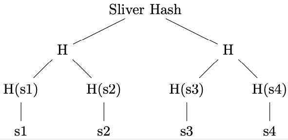
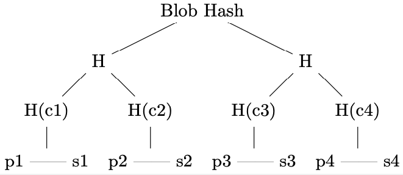

RedStuff has specific properties, Walrus-specific parameters, and authentication mechanisms described in the [RedStuff encoding algorithm](red-stuff).

## Properties and observations

The following sections describe key design decisions, fault-tolerance properties, and storage overhead of the RedStuff encoding.

### Why the rectangular layout?

The rectangular layout of the message matrix is an optimization for the Byzantine setting. When storing the blob, a client can only await $N - f$ responses, as the remaining $f$ shards might be Byzantine. Yet, $f$ of these $N-f$ might be the Byzantine ones, and the $f$ that did not reply were only slow due to network asynchrony. Therefore, the blob needs to be encoded such that $N-2f$ symbols are sufficient to recover the original blob. The primary encoding achieves this.

After the initial sharing phase, the honest shards share and reconstruct the missing slivers from each other. At a steady state, you can always assume that $N - f$ honest shards are in possession of their slivers. The secondary encoding can therefore have a higher rate, $(N-f)/N$, decreasing the storage overhead while maintaining the same fault tolerance properties.

### Worst-case initial sharing

The following describes how the $N-f$ honest shards can obtain their sliver pairs in the worst case outlined above, where the client shares the slivers with $N-f$ shards, and $f$ Byzantine shards drop them.

1. The $N-2f$ honest shards receive the sliver pairs.
2. The remaining $f$ honest shards are notified of the stored blob, such as through the chain, and start the process to recover their sliver pairs.
3. First, they recover their secondary slivers, as they can be decoded from $N-2f$ recovery symbols.
4. Then, once all $N-f$ honest shards have their secondary slivers, they can start recovering the primary slivers, which require $N-f$ recovery symbols.
5. All honest shards have their sliver pairs.

### Storage overhead

Assume for simplicity that $N=3f+1$. Then, the original blob is divided into roughly $f \cdot 2f = 2f^2$ symbols. The system stores $N \cdot 2f$ primary sliver symbols and $N \cdot f$ secondary sliver symbols, for a total storage of about $9f^2$ symbols.

Therefore, the storage overhead due to RedStuff encoding is about $9f^2 / 2f^2 = 4.5$ times the original blob size.

### Differences from the Twin-Code framework

The key modifications in RedStuff, compared to the original Twin-Code framework, are the following:

- RedStuff uses Reed-Solomon codes for both the Type 0 and Type 1 encoding, as they are called in the Twin-Code paper. The rates are $(N-2f)/N$ and $(N-f)/N$ respectively. The Type 0 encoding is called the primary encoding, and the Type 1 encoding the secondary encoding.
- The blob is not laid out in a square message matrix, but in a rectangular one. This is an optimization for the specific BFT setting described here.
- The system stores both Type 0 and Type 1 encodings on each shard. These form slivers, and the 2 together form a sliver pair.
- Twin-Code assumes crash faults and a trusted writer. RedStuff adds a commitment to every sliver, so shards can verify the slivers and symbols they receive and detect blobs that a malicious writer encoded inconsistently.

## Walrus-specific parameters and considerations

The following sections describe the concrete parameter choices and mechanisms that Walrus uses when applying the RedStuff encoding.

### Sliver-pair-to-shard mapping

The previous sections assumed that sliver pair $i$ is stored on shard $i$. In practice, the system maps sliver pairs to shards in a pseudo-random fashion to ensure that the systematic slivers, which contain the original data, are not always stored on the same shard.

This is important because systematic slivers are the most frequently accessed, as they allow you to access the data without any decoding.

The mapping works as follows: the system assigns each encoded blob a 32-byte pseudo-random blob ID. This ID is interpreted as an unsigned big-endian integer, and its remainder modulo $N$ serves as a rotation offset, such that sliver pair $i$ is stored on shard $(i + \text{offset}) \mod N$.

### Source symbol counts

Reed-Solomon codes are optimal: any $k$ of the $N$ encoded symbols always suffice to decode $k$ source symbols. The number of source symbols can therefore match the fault-tolerance thresholds exactly. The encoding configuration uses the following parameters:

- $f$, the maximum number of Byzantine shards, is $\lfloor (N-1) / 3 \rfloor$.
- The number of primary source symbols (equivalent to the number of symbols in a secondary sliver) is $N - 2f$.
- The number of secondary source symbols (equivalent to the number of symbols in a primary sliver) is $N - f$.

For example, the following settings apply:

| N shards |   f | Num primary | Num secondary |
|---------:|----:|------------:|--------------:|
|        7 |   2 |           3 |             5 |
|       10 |   3 |           4 |             7 |
|       31 |  10 |          11 |            21 |
|      100 |  33 |          34 |            67 |
|      300 |  99 |         102 |           201 |
|     1000 | 333 |         334 |           667 |

## Blob size limits

Walrus stores the symbol size as a 16-bit integer, and the Reed-Solomon implementation requires every symbol to have an even number of bytes. A symbol is therefore at least 2 bytes and at most $2^{16} - 2 = 65534$ bytes.

The system encodes the blob in the rectangular message matrix, which upper-bounds the blob size by `source_symbols_primary * source_symbols_secondary * 65534`. There is no minimum blob size: small blobs, including empty ones, use 2-byte symbols, so the encoded size has a lower bound instead. The encoded sizes below count the slivers only, not the metadata. A few examples for the same configurations as above:

| N shards | Max blob size | Min encoded blob size | Max encoded blob size |
|---------:|--------------:|----------------------:|----------------------:|
|        7 |        960 KiB |                 112 B |               3.50 MiB |
|       10 |       1.75 MiB |                 220 B |               6.87 MiB |
|       31 |       14.4 MiB |              1.94 KiB |               62.0 MiB |
|      100 |        142 MiB |               19.7 KiB |                631 MiB |
|      300 |       1.25 GiB |                178 KiB |               5.55 GiB |
|     1000 |       13.6 GiB |               1.91 MiB |               61.1 GiB |

## Sliver authentication, blob metadata, and the blob ID

Alongside the efficient encoding performed by RedStuff, shards need to be able to authenticate that the slivers and encoding symbols they receive belong to the blob they requested. This section briefly outlines how this works.

The system constructs a Merkle tree for each sliver, primary or secondary.

The system constructs the tree over all $N$ symbols of the fully expanded sliver. The root node of the Merkle tree (the sliver hash) appears in the metadata for the blob. To prove that a symbol is part of a sliver, the prover supplies the symbol alongside the Merkle path to the root hash, which every node has as part of the metadata.

The system then computes a Merkle tree over the sliver hashes to obtain a blob hash. It concatenates primary and secondary sliver hashes for each sliver pair, and then constructs the Merkle tree over the concatenations ($c_i$ in the figure). This construction reduces the number of hashing operations compared to hashing each sliver Merkle root individually.

To prove that a sliver is part of a blob, it is sufficient to provide the Merkle path to the root.

Finally, the encoding type tag (representing the RedStuff version or alternative encoding), the length of the blob before encoding, and the Merkle root of the tree over the slivers hash together to produce the blob ID.

### Metadata overhead

Each storage node stores the full metadata for the blob. The metadata consists of:

- A `32 B` Merkle root hash for each primary and secondary sliver.
- The `32 B` blob ID, computed as above.
- The erasure code type (`1 B`).
- The length of the unencoded blob size (`8 B`).

The hashes for the primary and secondary slivers can be a considerable overhead when the number of shards is high. The following table shows the cumulative size of the hashes stored on the system, depending on the number of nodes and shards.

| N shards | One node | floor(N/floor(log2(N))) nodes | N nodes |
|---------:|---------:|------------------------------:|--------:|
|        7 |    448 B |                       1.31 KiB | 3.06 KiB |
|       10 |    640 B |                       1.88 KiB | 6.25 KiB |
|       31 |  1.94 KiB |                       13.6 KiB | 60.1 KiB |
|      100 |  6.25 KiB |                        100 KiB |  625 KiB |
|      300 |  18.8 KiB |                        694 KiB | 5.49 MiB |
|     1000 |  62.5 KiB |                       6.77 MiB | 61.0 MiB |

The cumulative size of the hashes in the case of 1000 nodes (1 node per shard) is 62.5 KiB per node, or 61.0 MiB for a system of 1000 nodes. The number of shards is fixed and constant, while the number of nodes might vary, with each node having 1 or more shards, potentially lowering the overhead on the system. The following table shows the ratio between the size of the hashes stored on the system and the maximum blob size and the minimum and maximum encoded blob sizes, for `N=1000` shards and different numbers of nodes (1 node, floor(N/floor(log2(N))) = 111, and 1000).

| N = 1000                      | Total metadata size | Factor max blob | Factor min encoded blob | Factor max encoded blob |
| ----------------------------- | ------------------: | --------------: | ----------------------: | ----------------------: |
| Single node                   |            62.5 KiB |        4.38e-06 |                  0.0320 |                9.76e-07 |
| floor(N/floor(log2(N))) nodes |            6.77 MiB |        0.000487 |                    3.55 |                0.000108 |
| N nodes                       |            61.0 MiB |         0.00438 |                    32.0 |                0.000976 |

For realistic node counts and small blob sizes, the total metadata overhead can be a multiple of the size of the encoded blob. For larger blob sizes, the overhead is negligible.

---

**Reference**

[1] K. V. Rashmi, N. B. Shah and P. V. Kumar, "Enabling node repair in any erasure code for distributed storage," 2011 IEEE International Symposium on Information Theory Proceedings, St. Petersburg, Russia, 2011, pp. 1235-1239, doi: [10.1109/ISIT.2011.6033732](https://doi.org/10.1109/ISIT.2011.6033732).
